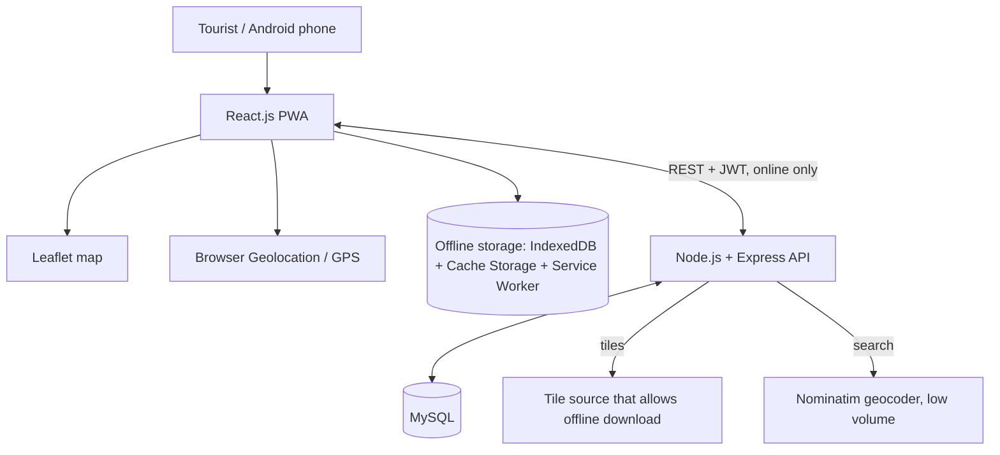
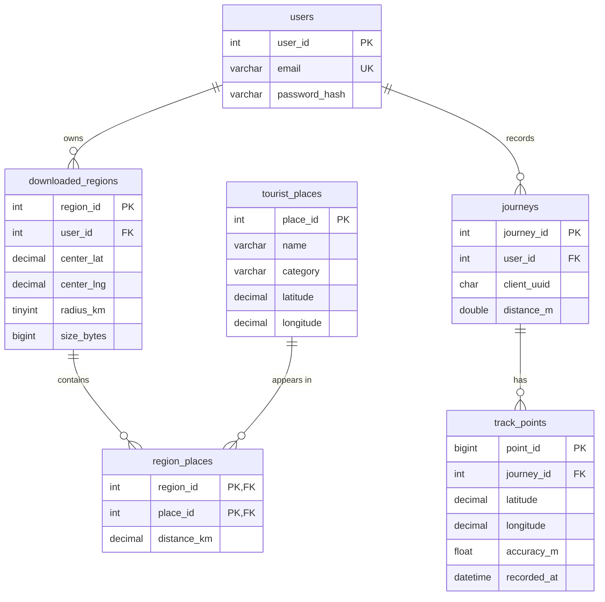

# RoamOffline
**An Intelligent Offline Tourist Navigation, Nearby Place Discovery and GPS Travel Tracking System**
React + Leaflet PWA · Node.js/Express REST API · MySQL · Service Worker + Cache Storage + IndexedDB

## 1. What it does
While online, the tourist searches a destination, picks a radius (5/10/20/30/50 km, max 50), sees the coverage circle, storage estimate and progress, and downloads **map tiles** (Cache Storage) and **tourist-place data** (IndexedDB). Offline, the saved map opens, the GPS dot appears, nearby places are listed by straight-line (Haversine) distance, journeys are recorded as polylines, and history/downloaded regions are managed. Only places that were really downloaded are shown offline.

## 2. IMPORTANT: map tile source
When online, Leaflet displays the OpenStreetMap standard tile service as a **view-only basemap**. This service is never used by the app's offline downloader; **do not bulk-download from tile.openstreetmap.org** (forbidden by its policy). To download maps for offline use, configure a permitted tile source. The app requests offline tiles from its own `/tiles/{z}/{x}/{y}.png` endpoint, which serves, in this order:
1. Files in `backend/tiles/{z}/{x}/{y}.png` (your own pre-rendered OpenStreetMap tiles, e.g. exported with a tool such as MOBAC from a source that allows it).
2. `TILE_UPSTREAM` in `backend/.env`: a self-hosted tile server (e.g. tileserver-gl with an OpenStreetMap extract from Geofabrik) or a commercial provider whose terms allow offline caching.

Set the matching `TILE_ATTRIBUTION`. With no offline tile source, the online basemap is still visible while connected, but offline map downloads will have missing tiles; places, GPS, boundary circles and tracking still work.

### Any place, up to 50 km
Search uses OpenStreetMap Nominatim, so any town, waterfall, hill or village in the world can be the destination. On Download, the backend asks OpenStreetMap (Overpass API, one query per download) for named places inside the circle (waterfalls, viewpoints, peaks, beaches, heritage sites, museums, parks, temples and places of worship, nature reserves, camp sites, dams, landmarks; hotels are excluded; the 2000 closest are kept), caches them in MySQL, and the phone saves them in IndexedDB. Remote areas with little OSM data will return fewer places. For a destination outside your tile coverage you need a worldwide `TILE_UPSTREAM`.
If you created the database before this update, run `database/upgrade_osm.sql` once in Workbench.

## 3. Install (Windows)
1. Install **Node.js LTS** (nodejs.org), **VS Code**, **MySQL Community Server + MySQL Workbench** (dev.mysql.com; remember the root password). Check in PowerShell: `node -v`, `npm -v`.
2. Unzip the project, open the `RoamOffline` folder in VS Code (File > Open Folder).
3. **Database:** open MySQL Workbench > connect to your local server > File > Open SQL Script > `database/roamoffline.sql` > click the lightning icon. Expected: database `roamoffline` with 6 tables (`tourist_places` starts empty and fills on your first download).
4. **Backend** (VS Code terminal, PowerShell):
```
cd backend
npm install
copy .env.example .env
notepad .env        # set DB_PASSWORD and JWT_SECRET (TILE_UPSTREAM if you have a tile source)
npm start
```
Expected: `RoamOffline running at http://localhost:5000`. Test: open http://localhost:5000/api/health.
5. **Frontend** (new terminal):
```
cd frontend
npm install
npm run build
```
Restart the backend (`npm start` in `backend`); it serves the built app at **http://localhost:5000**. (Dev mode: `npm run dev` in `frontend`, open http://localhost:5173.)

## 4. Run on an Android phone (secure context needed)
Geolocation, service workers and PWA install need **HTTPS or localhost**. A plain `http://192.168.x.x:5000` will NOT work. Choose one:
* **USB (best):** enable Developer options + USB debugging, install Android platform-tools, run `adb reverse tcp:5000 tcp:5000`, then open `http://localhost:5000` in Chrome on the phone (localhost counts as secure).
* **HTTPS tunnel:** `npx cloudflared tunnel --url http://localhost:5000` (or ngrok) and open the https URL on the phone.
Then Chrome menu > **Install app / Add to Home screen**. Allow Location when asked.
**Important:** the service worker and offline data belong to the origin you used. Always open the same address later.

## 5. Architecture

* **React** UI; **Leaflet** draws the map, circles, markers, polylines; **GPS** is the device sensor (no internet needed); **Service Worker** caches the app shell and answers tile requests from Cache Storage only when offline; **Cache Storage** holds tiles; **IndexedDB** holds regions, places, journeys, download state; **Express** holds auth and REST; **MySQL** is the central online database (accounts, region metadata, master place list, cloud backup of journeys).
* **Offline never touches MySQL.** Download copies data MySQL > IndexedDB. Journeys are recorded in IndexedDB and uploaded to MySQL when internet returns (idempotent through `client_uuid`).

## 6. Methodology

```mermaid
flowchart LR
 A[1 Register/Login] --> B[2 Destination search] --> C[3 Coverage selection] --> D[4 Radius max 50 km] --> E[5 Download map + places] --> F[6 Local storage] --> G[7 Offline map] --> H[8 GPS location] --> I[9 Nearby places] --> J[10 Haversine distance] --> K[11 Path recording] --> L[12 Travel history] --> M[13 Downloaded-map management]
```

1 bcrypt-hashed password, JWT kept on the phone. 2 Local DB + Nominatim give coordinates. 3-4 The user picks a circle; tiles inside its bounding box are computed (zoom 9 to 15/14/13 depending on radius). 5 Places come from MySQL within the radius; tiles are fetched 6 at a time. 6 Tiles to Cache Storage, places/regions to IndexedDB; interrupted downloads resume because cached tiles are skipped. 7 Service worker serves tiles only from cache offline. 8 `watchPosition` with high accuracy. 9 Places are read from IndexedDB. 10 Haversine straight-line distance (not road distance). 11 Readings worse than ±50 m, jitter under 3 m, and jumps above 55 m/s are rejected. 12 Journeys listed, viewed, deleted. 13 Regions updated, deleted; unused tiles purged; storage warning above 80%.

## 7. ER diagram

`users` accounts; `downloaded_regions` one row per download (1:N with users); `tourist_places` master places; `region_places` many-to-many link between regions and places; `journeys` one per recording; `track_points` GPS samples (1:N). All FKs cascade on delete. Indexes: email (unique), `(latitude,longitude)`, category, `(user_id,client_uuid)` unique, `(journey_id,seq)`.

## 8. API (all except auth/health need `Authorization: Bearer <token>`)
| Method | Route | Purpose |
|---|---|---|
| POST | /api/auth/register `{fullName,email,password}` | create account, returns token |
| POST | /api/auth/login `{email,password}` | login |
| GET | /api/destinations/search?q= | find destinations |
| GET | /api/places/nearby?lat=&lng=&radius= | places within radius (max 50 km) |
| GET/POST | /api/regions | list / record a downloaded region |
| PUT/DELETE | /api/regions/:id | refresh / delete a region |
| POST/GET | /api/journeys | back up / list journeys |
| GET/DELETE | /api/journeys/:uuid | journey with points / delete one |
| DELETE | /api/journeys/all | delete all of the user's journeys |
| GET | /tiles/:z/:x/:y.png | tile endpoint (see section 2) |

**Postman:** POST `http://localhost:5000/api/auth/register` (Body > raw > JSON) `{"fullName":"Test","email":"t@t.com","password":"secret1"}`; copy `token`; for other requests use Authorization > Bearer Token. Try `GET /api/places/nearby?lat=12.4244&lng=75.7382&radius=50` (after you have downloaded a region near Madikeri once).

## 9. Offline test procedure
1. Online, open the app, register/log in. 2. Get map > search "Abbey Falls" (or "Madikeri"). 3. Choose 50 km; see circle, tile count, storage estimate, place count. 4. Download; wait for "Download complete". 5. Offline tab/Map shows the region. 6. Turn off Wi-Fi and mobile data; badge shows **Offline**. 7. Close and reopen the app from the home screen. 8. Map: green dashed boundary, saved places, blue GPS dot (accuracy shown). 9. Nearby list: sorted by "≈ distance", category chips filter. 10. Track > Start, walk 100 m+, Pause/Resume, Stop. 11. History: view path, delete one journey; "Delete all" asks confirmation. 12. Offline maps: size, radius, date shown; reconnect and press Update/Back up. 13. Pan outside the circle offline: no tile requests go out (blank area). **Expected:** nothing in 6-13 needs internet.

## 10. Test cases
| # | Case | Expected |
|---|---|---|
| 1 | Register duplicate email | 409 "already registered" |
| 2 | Wrong password | 401 |
| 3 | Radius 60 via API | 400 (max 50) |
| 4 | Close tab during download, reopen | Resume banner; no tile re-fetch |
| 5 | Deny location | clear permission message |
| 6 | GPS accuracy > 50 m while recording | point ignored, counter increases |
| 7 | Jump > 200 km/h | point ignored |
| 8 | Delete all history | confirm dialog first |
| 9 | Delete region | region, places, unused tiles removed |
| 10 | Offline refresh | app still loads |

## 11. Screenshots to capture
Login, Home, destination results, radius circle + estimate, download progress, completed download, offline map with GPS dot (airplane mode visible), nearby list, recording with polyline, history, offline maps management, Workbench tables, Postman responses.

## 12. Limitations
Tile source must be supplied by you (licensing). Browser storage quotas vary (50 km at high zoom can be large). Distances are straight-line. Background GPS stops if the phone locks the screen/browser sleeps (keep the screen on). iOS Safari may evict cache. Offline deletions are not queued for MySQL. Places come only from OpenStreetMap, so sparse areas return fewer results. Overpass is a free shared service; avoid repeated large downloads.

## 13. Future enhancements
Offline routing (self-hosted OSRM/Valhalla or vector tiles), vector offline maps, Wake Lock for tracking, GPX export, background sync queue, Overpass importer for places, Capacitor Android APK, SOS/offline emergency contacts.

## 14. Demo procedure
Show the DB in Workbench; log in online; download a 50 km region of "Madikeri"; show estimate/progress; switch to airplane mode; reopen the app; show map, GPS dot, nearby places and distances; record a short walk; stop; open history and delete one; show Offline maps storage; reconnect and press Back up.
